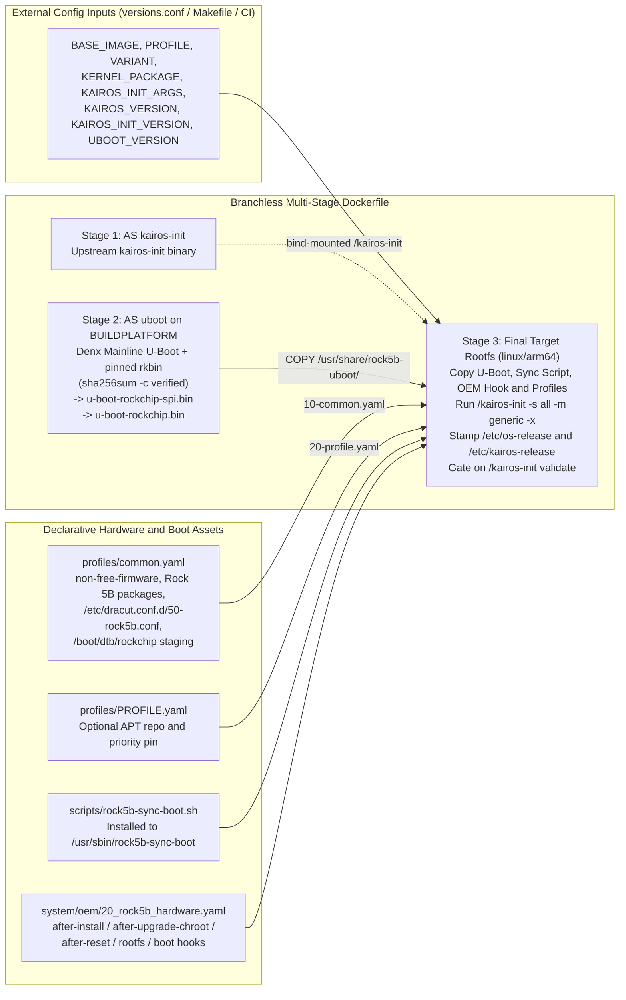
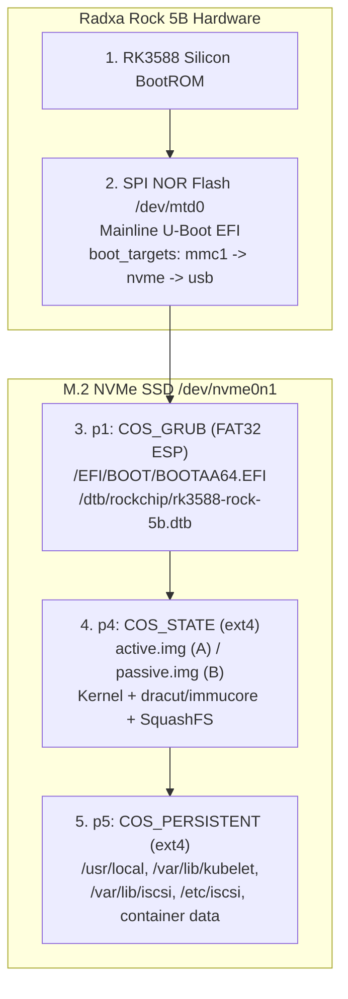
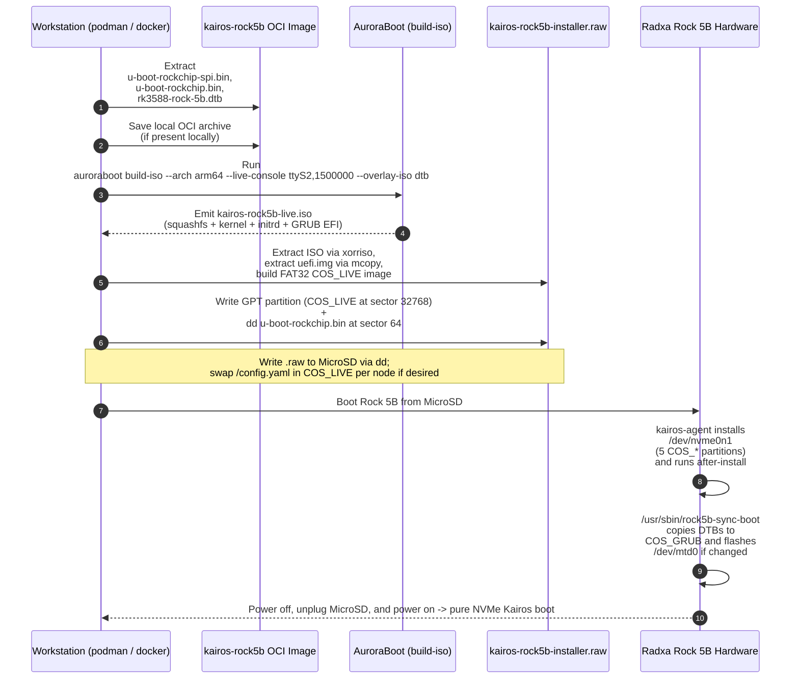
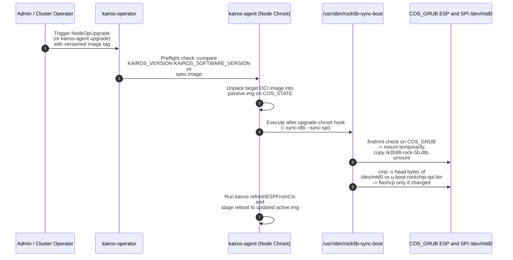

# Repository & Boot Architecture (`kairos-rock5b`)

This document explains how `kairos-rock5b` works end-to-end: how declarative configuration drives the branchless container build on top of upstream **Kairos**, how the Radxa Rock 5B boots from SPI NOR flash to NVMe, and how Day-1 installation (`AuroraBoot`) and Day-2 upgrades maintain Device Trees and U-Boot safely.

---

## 1. How the Repository Works: Config Over Branching Code

`kairos-rock5b` delegates OS initialization, dracut `initramfs` construction, Kubernetes/init provisioning, and image validation to upstream `kairos-init`, injecting Rock 5B hardware enablement cleanly through declarative `yip` **stage extensions** (`-x`) and an isolated multi-stage U-Boot builder. [`Dockerfile`](../Dockerfile) contains zero shell `if`/`elif`/`case` branches:

### Division of Labor: Upstream `kairos-init` vs `kairos-rock5b`

| Layer | Provided by Upstream `kairos-init` | Added by `kairos-rock5b` |
| :--- | :--- | :--- |
| **Core Kairos Runtime** | `immucore`, `kairos-agent`, A/B boot & reset scaffolding, `/system/oem/00_rootfs.yaml` bind mounts | Hardware-specific [`20_rock5b_hardware.yaml`](../system/oem/20_rock5b_hardware.yaml) (`CUSTOM_BIND_MOUNTS: /var/lib/iscsi`) |
| **Kernel & Initramfs** | Installs Debian `linux-image-arm64`, runs `dracut` to generate `/boot/initrd` with `dm_snapshot`, creates `/boot/vmlinuz` | Configures optional `*-backports` pin, adds `/etc/dracut.conf.d/50-rock5b.conf`, stages `/boot/dtb/rockchip/` |
| **Orchestrator & Storage** | Installs `open-iscsi`, `cryptsetup`, `nfs-common`, `multipath-tools`, optional `k3s`/`k0s` binary + units | Adds `firmware-realtek`, `gdisk`, `mtd-utils`, `parted`, `u-boot-tools`, disables/masks `multipathd`, and configures NVMe/MMC multipath blacklist |
| **Bootloader** | Generic `GRUB2` EFI (`BOOTAA64.EFI`) for UEFI `arm64` systems | Compiles Denx Mainline U-Boot (`rock5b-rk3588_defconfig`) + `rock5b-sync-boot` for `COS_GRUB` DTBs & `/dev/mtd0` |
| **Validation & Metadata** | `/kairos-init validate` (kernel/initrd/systemd/getty/single-kernel gates) | Stamps profile + resolved numeric kernel version onto OCI tags, `/etc/os-release`, and `/etc/kairos-release` |

### Repository File & Lifecycle Execution Map

| File | Runs When | Responsibility |
| :--- | :--- | :--- |
| [`versions.conf`](../versions.conf), [`Makefile`](../Makefile) & [`.github/workflows/build.yaml`](../.github/workflows/build.yaml) | Build orchestration | Centralizes pinned tool/RKBIN/orchestrator versions + optional kernel ABI pins (`BPO_KERNEL_VERSION` / `LTS_KERNEL_VERSION`) and resolves `KERNEL_PACKAGE` + `KAIROS_INIT_ARGS` |
| [`profiles/common.yaml`](../profiles/common.yaml) & `profiles/<profile>.yaml` | Image build (`kairos-init -x`) | Declarative APT repos/pins (`before-install`), packages + dracut config (`install`), DTB staging (`after-install`) |
| [`Dockerfile`](../Dockerfile) | Image build (`podman` / `docker`) | Builds U-Boot, layers Rock 5B files + generated `15-kernel.yaml`, runs `/kairos-init -s all -x --skip-step installKernel`, stamps metadata, cleans `/etc/kairos-init`, validates |
| [`scripts/verify-image.sh`](../scripts/verify-image.sh) | Post-build CI / local verification | Verifies kernel, initrd RK3588 drivers, `rk3588-rock-5b.dtb`, U-Boot bins, `/etc/kairos-release`, tools, and OEM hooks |
| [`scripts/build-installer-img.sh`](../scripts/build-installer-img.sh) | Day-1 media creation | Extracts DTB + U-Boot bins, invokes `auroraboot build-iso`, packages GPT `COS_LIVE` + sector-64 `u-boot-rockchip.bin` |
| [`scripts/flash-spi-uboot.sh`](../scripts/flash-spi-uboot.sh) | Optional pre-install SSH prep | Idempotently flashes `u-boot-rockchip-spi.bin` to `/dev/mtd0` from an existing Linux install |
| [`system/oem/20_rock5b_hardware.yaml`](../system/oem/20_rock5b_hardware.yaml) | Runtime (`rootfs`, `initramfs`, `boot`, `after-*`) | Persists `/var/lib/iscsi`, ensures `multipathd` stays masked, runs `rock5b-sync-boot`, writes multipath blacklist, loads `iscsi_tcp`/`dm_crypt` |
| [`scripts/rock5b-sync-boot.sh`](../scripts/rock5b-sync-boot.sh) | Install, Upgrade, Reset | `findmnt`-safe copy of `/boot/dtb/rockchip/` to `COS_GRUB` + `cmp -s`-gated `/dev/mtd0` SPI flash |

---

## 2. Hardware Boot Sequence on Radxa Rock 5B (`RK3588`)

Unlike x86_64 servers with onboard ACPI/UEFI firmware capable of reading NVMe drives natively, the **Rockchip RK3588** silicon BootROM cannot initialize PCIe 3.0 directly. Instead, the RK3588 BootROM searches for a first-stage bootloader in fixed hardware order:

1. **Onboard 16 MB SPI NOR Flash (`/dev/mtd0`)**
2. **eMMC Module (`mmc0`)**
3. **MicroSD Card Slot (`mmc1` / `/dev/mmcblk1`)**

`kairos-rock5b` compiles **Mainline U-Boot (`rock5b-rk3588_defconfig`, EFI + PCIe NVMe enabled)** paired with pinned `rockchip-linux/rkbin` DRAM TPL and TF-A BL31 blobs into `/usr/share/rock5b-uboot/u-boot-rockchip-spi.bin` (for `/dev/mtd0`) and `u-boot-rockchip.bin` (embedded at sector 64 of the installer `.raw` image).

With Mainline U-Boot EFI in `/dev/mtd0`:
- **When the installer MicroSD card is inserted**: `boot_targets` hits `mmc1` first, loading `/dtb/rockchip/rk3588-rock-5b.dtb` and `/EFI/BOOT/BOOTAA64.EFI` from `COS_LIVE`. Even if `/dev/mtd0` is completely empty on a brand-new board, the RK3588 BootROM falls back to sector 64 (`32 KiB`) of the MicroSD installer (`u-boot-rockchip.bin`), and `after-install` flashes `/dev/mtd0` automatically.
- **Once the MicroSD card is removed**: U-Boot scans `nvme` and boots `/EFI/BOOT/BOOTAA64.EFI` (GRUB2) + `/dtb/rockchip/rk3588-rock-5b.dtb` from the NVMe `COS_GRUB` partition.

---

## 3. Day-1 Provisioning Pipeline (`AuroraBoot` -> Auto-Install)

[`scripts/build-installer-img.sh`](../scripts/build-installer-img.sh) avoids loop devices (`/dev/loop-control`) completely so users can assemble a bootable `.raw` MicroSD image rootlessly on any Linux workstation:

---

## 4. Day-2 Atomic A/B Upgrades

Upgrades run atomically—either via CLI (`sudo kairos-agent upgrade --source oci:<image>`) or via `kairos-operator` (`NodeOpUpgrade`)—by replacing `passive.img` on `COS_STATE` and flipping the GRUB boot target:

### Why `rock5b-sync-boot` Checks `findmnt` and `cmp -s`
1. **No Dual VFAT RW Mount**: During `after-install` and `after-reset`, `kairos-agent` already holds `COS_GRUB` (`FAT32`) mounted read-write, whereas `after-upgrade-chroot` runs *before* `refreshESPFromCtx` mounts the ESP. Checking `findmnt -rn -S "${ESP_DEV}" -o TARGET` lets [`rock5b-sync-boot.sh`](../scripts/rock5b-sync-boot.sh) reuse an existing mount point when present and perform a clean temporary mount/unmount only during upgrades, backed by `EXIT` and `RETURN` cleanup traps so any copy or sync failure unmounts the temporary mount point before exit and prevents VFAT dual-write corruption.
2. **Zero Unnecessary SPI NOR Wear**: [`rock5b-sync-boot.sh`](../scripts/rock5b-sync-boot.sh) and [`flash-spi-uboot.sh`](../scripts/flash-spi-uboot.sh) compare `head -c "${SPI_SIZE}" /dev/mtd0` byte-for-byte (`cmp -s`) against `/usr/share/rock5b-uboot/u-boot-rockchip-spi.bin`, calling `flashcp -v` only when the U-Boot binary actually changes.

---

## 5. Kairos NVMe GPT Partition & Persistence Layout

On a clean full-disk installation (`install.device: /dev/nvme0n1`), Kairos formats five GPT partitions:

| Partition | Label | Filesystem | Purpose |
| :--- | :--- | :--- | :--- |
| `nvme0n1p1` | `COS_GRUB` | `vfat` (FAT32) | UEFI System Partition (`/EFI/BOOT/BOOTAA64.EFI` + `/dtb/rockchip/rk3588-rock-5b.dtb`) |
| `nvme0n1p2` | `COS_OEM` | `ext4` | Node-specific `/oem` cloud-config (`90_custom.yaml`) preserved across A/B upgrades |
| `nvme0n1p3` | `COS_RECOVERY` | `ext4` | Immutable fallback recovery SquashFS image (`recovery.img`) |
| `nvme0n1p4` | `COS_STATE` | `ext4` | A/B immutable SquashFS root images (`active.img` and `passive.img`) |
| `nvme0n1p5` | `COS_PERSISTENT` | `ext4` | Persistent writable storage bind-mounted over the immutable rootfs |

Upstream `kairos-init` (`00_rootfs.yaml`) persists standard system, Kubernetes, and storage directories on `COS_PERSISTENT`. [`system/oem/20_rock5b_hardware.yaml`](../system/oem/20_rock5b_hardware.yaml) adds `/var/lib/iscsi` via `CUSTOM_BIND_MOUNTS` so iSCSI initiator IQNs and session metadata persist cleanly across upgrades and resets for any CSI/block storage stack.
