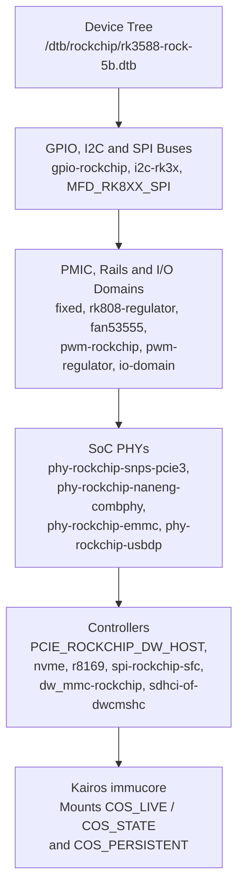

# Hardware Support & Driver Matrix (`kairos-rock5b`)

This document defines the target **Radxa Rock 5B** (`Rockchip RK3588`, `linux/arm64`) hardware support scope, how official Debian multi-platform `linux-image-arm64` kernels satisfy RK3588 subsystems, the early-boot `initramfs` dependency chain, and how Debian kernel tracks (`*-bpo` Backports vs Stable LTS) compare.

---

## 1. Hardware Support Scope ("What We Want vs Non-Goals")

`kairos-rock5b` targets **headless Kubernetes and edge appliance nodes running directly off M.2 NVMe** without permanent MicroSD cards and without third-party OS or kernel APT repositories.

| Support Tier | Hardware Capability | Status in `kairos-rock5b` | How It Is Provided |
| :--- | :--- | :--- | :--- |
| **Tier 1: Mandatory Out-of-the-Box** | **RK3588 CPU & DVFS** (big.LITTLE Cortex-A76 + Cortex-A55, RK806 SPI PMIC, I2C buck regulators) | Supported & Verified | Core PMIC (`MFD_RK8XX_SPI`) + modular `cpufreq-dt`, `rk808-regulator`, `fan53555`, `i2c-rk3x` |
| **Tier 1: Mandatory Out-of-the-Box** | **Onboard 16 MB SPI NOR Flash (`/dev/mtd0`)** for pure NVMe boot | Supported & Verified | Upstream Denx Mainline U-Boot EFI + `spi-rockchip-sfc` + `mtd-utils` (`flashcp`) |
| **Tier 1: Mandatory Out-of-the-Box** | **M.2 M-Key PCIe 3.0 x4 NVMe (`/dev/nvme0n1`)** primary root & persistent storage | Supported & Verified | `PCIE_ROCKCHIP_DW_HOST` + initrd `phy-rockchip-snps-pcie3`, `fixed`, `nvme`, `nvme-core` |
| **Tier 1: Mandatory Out-of-the-Box** | **Onboard 2.5GbE LAN (`Realtek RTL8125B`)** | Supported & Verified | Initrd `r8169` + `phy-rockchip-naneng-combphy` + `firmware-realtek` (`/lib/firmware/rtl_nic/rtl8125*`) |
| **Tier 1: Mandatory Out-of-the-Box** | **MicroSD (`mmc1`) & eMMC (`mmc0`)** installer media and optional local boot | Supported & Verified | Initrd `dw_mmc-rockchip`, `sdhci-of-dwcmshc`, `phy-rockchip-emmc` + sector-64 U-Boot image |
| **Tier 1: Mandatory Out-of-the-Box** | **USB 2.0 / USB 3.0 / USB-C** installer media, NICs, and serial adapters | Supported & Verified | `phy-rockchip-inno-usb2`, `phy-rockchip-usbdp`, `phy-rockchip-typec` |
| **Tier 1: Mandatory Out-of-the-Box** | **PWM Heatsink Fan & Thermal Throttling** (multi-zone TSADC + PWM fan header) | Supported & Verified | `pwm-rockchip` (in initrd) + `pwm-fan` + `rockchip_thermal` |
| **Tier 1: Mandatory Out-of-the-Box** | **UART2 Serial Console (`1500000 8N1`)**, RTC, Hardware Watchdog, RNG, Crypto | Supported & Verified | `RTC_DRV_RK808`, `ttyS2`, `dw_wdt`, `rockchip-rng`, `rk_crypto` |
| **Tier 1: Mandatory Out-of-the-Box** | **Cloud-Native & CSI Storage Primitives** (`open-iscsi`, LUKS `dm_crypt`, NFS, multipath guard) | Supported & Verified | `kairos-init` base packages + `/var/lib/iscsi` persistence + `multipathd` disabled/masked & `/etc/multipath.conf` guard (`common.yaml` + `20_rock5b_hardware.yaml`) |
| **Tier 2: Optional Profile / Add-On** | **HDMI / USB-C DP Text Console (`tty1`)** | Kernel driver present | `rockchipdrm` + `phy-rockchip-samsung-hdptx` + `phy-rockchip-inno-hdmi` / `phy-rockchip-dp` |
| **Tier 2: Optional Profile / Add-On** | **Arm Mali-G610 GPU Compute / Vulkan (`panthor`)** | Kernel module present (`=m`) | Layer `firmware-misc-nonfree` via a custom `profiles/<name>.yaml` to supply `mali_csffw.bin` |
| **Tier 2: Optional Profile / Add-On** | **M.2 E-Key Wi-Fi / Bluetooth Cards** | Add via profile/cloud-config | Install card-specific `firmware-*` packages and `wpasupplicant` via a custom profile |
| **Tier 2: Kernel-Gated** | **RK3588 NPU (`rocket` DRM accel)** | Picked up automatically when enabled upstream | When Debian enables `CONFIG_DRM_ACCEL_ROCKET` in `linux-image-arm64`, rebuilding the profile activates it without repo changes |
| **Tier 3: Explicit Non-Goals** | **Out-of-tree vendor BSP kernels**, proprietary multimedia/NPU blobs, DKMS modules | Excluded by design | Keeps builds 100% pure `deb.debian.org` and upgrades atomic across Debian kernel updates |

---

## 2. Debian `linux-image-arm64` Kernel & Driver Architecture

Unlike board-specific vendor kernels that statically compile (`=y`) all SoC buses and PHYs, official Debian `linux-image-arm64` kernels use a multi-platform modular split. Core boot-critical SoC bridges (`PCIE_ROCKCHIP_DW_HOST`, `MFD_RK8XX_SPI`, `PINCTRL_ROCKCHIP`, `PINCTRL_RK805`, `ROCKCHIP_PM_DOMAINS`, `RTC_DRV_RK808`, `CPUFREQ_DT_PLATDEV`) are typically built in (`=y`), while regulators, clocks, buses, PHYs, and storage/network controllers are built as loadable kernel modules (`=m`).

[`scripts/verify-image.sh`](../scripts/verify-image.sh) verifies every built image generically against both `lsinitrd /boot/initrd` and `modules.builtin`, so future Debian kernel updates continue passing even if a subsystem moves between `=m` and `=y`.

| Hardware Subsystem | Onboard Hardware / Bus | Key Kernel Subsystems & Drivers | Userspace / Firmware | Boot Stage Needed |
| :--- | :--- | :--- | :--- | :--- |
| **PCIe 3.0 x4 NVMe Slot** | M.2 M-Key (`/dev/nvme0n1`) | `PCIE_ROCKCHIP_DW_HOST`, `phy-rockchip-snps-pcie3`, `nvme`, `nvme-core` | `gdisk`, `parted` | `SPI U-Boot` + `dracut initrd` |
| **NVMe Power Rail** | `vcc3v3_pcie30` GPIO regulator | `gpio-rockchip`, `fixed`, `gpio-regulator`, `PINCTRL_ROCKCHIP` | `rk3588-rock-5b.dtb` | `dracut initrd` |
| **2.5GbE Ethernet** | Realtek `RTL8125B` on PCIe 2.0 | `r8169`, `phy-rockchip-naneng-combphy`, `PCIE_ROCKCHIP_DW_HOST` | `firmware-realtek` (`/lib/firmware/rtl_nic/rtl8125*`) | `dracut initrd` (recovery & cluster) |
| **16 MB SPI NOR Flash** | `/dev/mtd0` (`spi_rockchip_sfc`) | `spi-rockchip-sfc`, `spi-rockchip` | `mtd-utils` (`flashcp`) | `dracut initrd` + `rootfs` (`rock5b-sync-boot`) |
| **MicroSD & eMMC Slots** | `mmc1` (SD), `mmc0` (eMMC) | `dw_mmc-rockchip`, `sdhci-of-dwcmshc`, `phy-rockchip-emmc` | Sector-64 `u-boot-rockchip.bin` on installer SD | `dracut initrd` (installer / eMMC) |
| **PMIC & Power Rails** | RK806 (`SPI`), I2C bucks, PWM rails | `MFD_RK8XX_SPI`, `PINCTRL_RK805`, `rk808-regulator`, `fan53555`, `i2c-rk3x`, `pwm-rockchip`, `pwm-regulator`, `io-domain`, `ROCKCHIP_PM_DOMAINS` | `rk3588-rock-5b.dtb` | `dracut initrd` |
| **Thermal, Fan & CPU DVFS** | PWM fan header + TSADC + OPP tables | `pwm-rockchip`, `pwm-fan`, `rockchip_thermal`, `cpufreq-dt`, `CPUFREQ_DT_PLATDEV` | Kernel thermal governor | `dracut initrd` / `rootfs` |
| **RTC, Watchdog, Entropy & Crypto** | RK806 RTC, `dw_wdt`, TRNG, CE | `RTC_DRV_RK808`, `dw_wdt`, `rockchip-rng`, `rk_crypto`, `nvmem-rockchip-otp` | `systemd-timesyncd`, `systemd` watchdog | `rootfs` |
| **USB Host & Type-C** | USB 2.0/3.0 + USB-C PHY | `phy-rockchip-inno-usb2`, `phy-rockchip-usbdp`, `phy-rockchip-typec` | Standard Linux USB stack | `dracut initrd` |
| **Display & GPU (Optional)** | HDMI, DP, Mali-G610 | `rockchipdrm`, `panthor`, `phy-rockchip-samsung-hdptx` | Optional `firmware-misc-nonfree` | `rootfs` |

---

## 3. Early-Boot Dependency Chain (`initramfs`)

Because Debian packages RK3588 buses, regulators, and PHYs as loadable modules, `/etc/dracut.conf.d/50-rock5b.conf` (declared in [`profiles/common.yaml`](../profiles/common.yaml)) embeds the full dependency chain into `/boot/initrd` before `immucore` probes `/dev/nvme0n1` (`COS_STATE`) or installer media (`COS_LIVE`):

---

## 4. Debian Kernel Track Comparison (`Backports` vs `Stable LTS`)

Both shipped profiles pull **100% official `deb.debian.org` packages** and share identical [`profiles/common.yaml`](../profiles/common.yaml) hardware hooks:

| Attribute | Debian Backports (`debian-trixie-bpo`, Default) | Debian Stable LTS (`debian-trixie`) |
| :--- | :--- | :--- |
| **APT Source** | Official Debian `*-backports` suite (`Pin-Priority: 990` for `linux-*` and `firmware-*`) | Stock Debian stable archive only (zero extra APT sources) |
| **Kernel Lifecycle** | Tracks newer upstream mainline Linux releases packaged for Debian | Tracks the Debian release's long-term support kernel series with security backports |
| **Device Tree (`rk3588-rock-5b.dtb`)** | Picks up newer upstream RK3588 DT nodes (peripheral, power, thermal, display/USB-C additions) continuously | Conservative upstream RK3588 DT baseline covering core NVMe, PCIe, 2.5GbE, SPI, PWM, and thermal hardware |
| **`firmware-realtek`** | Tracks backported Realtek NIC firmware updates | Tracks stable archive Realtek NIC firmware |
| **When to Choose** | Recommended when you want the newest upstream RK3588 mainline enablement and fixes | Best when you prefer minimal kernel major-version churn across security rebuilds |
